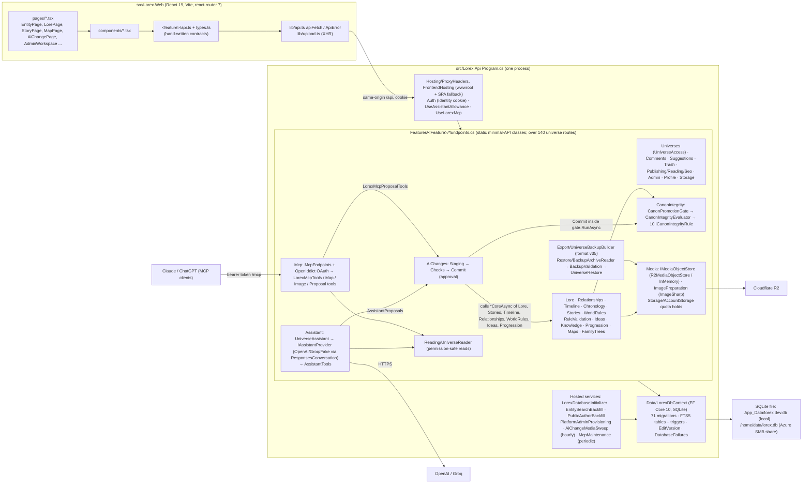

# Architecture & Code Quality Audit (issue #55)

Date: 2026-10-25. Auditor: Claude Code session, read-only except for this file.
Scope: issue #55's seven dimensions. Security and privacy testing belong to #33; where this audit
touched a security-adjacent fact it is listed under "Hand-offs to #33" and not assessed further.

## 0. Audit baseline

| Item | Value |
| --- | --- |
| Branch | `dev` |
| Commit | `a12ea9ca31e97b985737d1fc0c2aa5d88ef3f54b` (Merge `feat/mcp-full-creator-authoring` #59) |
| Working tree at start | clean (`git status --porcelain` empty) |
| Worktrees present (left untouched) | 12 under `worktrees/` plus `.claude/worktrees/lore-duplicate`; none used |
| Files changed by this audit | this report only. No application code, no commit, no GitHub writes |
| `AGENTS.md` | does not exist in the repository. `CLAUDE.md`, `.claude/CLAUDE.md`, `STATE.md`, `SYSTEMS.md` and the ADR index were read instead |

Commands run (outputs in the session scratchpad, not the repo): `dotnet build Lorex.slnx -c Release`,
`dotnet test tests/Lorex.Api.Tests -c Release --no-build` (in-memory SQLite, never touches
`App_Data`), `npm run typecheck|lint|build|test` in `src/Lorex.Web` (output to gitignored `dist/`),
read-only `gh issue view` / `gh run list|view`, and a read-only (`mode=ro`) inspection of
`src/Lorex.Api/App_Data/lorex.dev.db`. No Playwright run locally (the full suite is CI's job); E2E
evidence comes from CI logs.

## 1. As-is component and dependency diagram

Dependency facts behind the diagram (all from code):

- Every endpoint takes `LorexDbContext` directly; no repository or service layer (CLAUDE.md hard
  boundary, held). `Program.cs:97-155` registers 56 `Map*Endpoints` calls.
- One permission gate: `Features/Universes/UniverseAccess.cs:70-148`, 210 call sites
  (`DenyAsync` 170, `Allows` 17, `RoleAsync` 11, `AuthorizeAsync` 10). `AiChangePermissions`
  (`AiChanges/AiChangeChecks.cs:379-413`) derives from `UniverseAccess.Allows`, it is not a second matrix.
- AI writes reuse the hand-written write paths: `AiChangeCommit.cs:344-536` dispatches to
  `EntityEndpoints.CreateEntryAsync/UpdateCoreAsync`, `StoryEndpoints.*CoreAsync`,
  `TimelineEndpoints.*CoreAsync`, `RelationshipEndpoints.*CoreAsync`, `WorldRuleEndpoints.*CoreAsync`,
  `ProgressionEndpoints.WriteAsync`, and so on. So AiChanges depends on 15+ feature endpoint classes.
- The Assistant and MCP share `Reading/UniverseReader` for reads and `AiChangeStaging.StageAsync`
  for proposals (`Assistant/AssistantProposals.cs`, `Mcp/LorexMcpProposalTools.cs`).
- Interfaces in the API: 5 (`IAssistantProvider`, `IAssistantConversation`, `ICanonIntegrityRule`,
  `IMediaObjectStore`, `IPublishable`). Each has two or more real implementations, so there is no
  single-implementation indirection to remove.

Sizes (measured, non-migration C#: 71,369 lines): Lore 9,921 · AiChanges 8,428 · Restore 6,414 ·
Stories 4,761 · Mcp 3,893. Largest files: `Restore/BackupValidation.cs` 2,717,
`Lore/EntityTypeEndpoints.cs` 1,845, `Restore/UniverseRestore.cs` 1,753, `Lore/EntityEndpoints.cs`
1,632. Web: 270 TS/TSX files, 61,186 lines; largest `pages/EntityPage.tsx` 1,805.

## 2. Findings register

Severity: High / Medium / Low. Confidence: Measured (reproduced or counted), Code-read (behaviour
follows from the code but was not exercised), Plausible (risk without a measurement).

### 2.1 Must fix before alpha

#### M1. `dev` HEAD is red: 2 backend + 2 E2E tests fail, so the #59 deploy is skipped

> **Status:** fixed separately on `dev` (`fe34bd8`, `b172b50`), not by this remediation.

- **Evidence (Measured).** CI run 40240222369 on `a12ea9c`: `Backend (shard 1/3)` and `(3/3)`,
  `End to end (shard 5/6)` and `(6/6)` failed; `Deploy: skipped`. Reproduced locally in the
  Release test run:
  - `MapMigrationTests.Rolled_back_and_forward_only_the_map_tables_move...`
    (`tests/Lorex.Api.Tests/MapMigrationTests.cs:66-68`) and
    `MapCalibrationMigrationTests.Rolled_back_and_forward...` (`MapCalibrationMigrationTests.cs:62`):
    `Assert.Equal() Failure: Collections differ`. The expected list still holds
    `IX_AiChangeMedia_OperationId on AiChangeMedia`. Cause: rolling back to before maps also rolls
    back the later #59 migrations (`AddSchemaProposals`, `AddDefinitionProposals`,
    `AddProgressionProposals`, `AddAiChangeMedia`, `AddMcpUniverseAliases`), but these two tests
    filter out only the map tables instead of going through `LaterSchema`.
  - `specs/shell.spec.ts:73` and `specs/workspace-settings.spec.ts:174`: `Expected: 15 Received: 16`
    links in the `Universe` navigation. The sidebar gained a link and the pins were not moved.
- **Impact.** DEV cannot receive #59, and every later merge inherits a red baseline that hides new
  failures.
- **Smallest change.** Test-only: filter the map tests' expected index list through a
  `LaterSchema.BeforeMaps` predicate (the same shape as the existing `Before*` ones), and update the two
  specs to the 16-link sidebar.
- **Regression scope.** The two migration test classes, the two specs, then the CI run on `dev`.
- **Risk.** Very low. Test code only.

#### M2. Merges reach `dev` before CI has validated them

> **Status:** process only. Left with the owner; no code change (section 7).

- **Evidence (Measured).** `gh run list` over the last 40 runs: 28 success, 11 failure. Every run
  is `Deploy DEV` on `push` to `dev`. `ci.yml` validates pull requests into `dev`, but most merges are
  local `Merge branch '…' into dev` commits that are pushed directly. Examples:
  `specs/trash-permanent-delete.spec.ts:330` failed identically on three consecutive dev pushes
  (runs 40137578174, 40180740487, 40184813329, 2026-10-24 22:12 to 2026-10-25 10:26) until
  `fb3304b fix/trash-e2e-row`. M1 is the same pattern again.
- **Impact.** `dev` is the deploy branch. A failure that is deterministic (not a flake) blocks DEV
  until someone notices, and stacked merges make the cause harder to isolate. Alpha testers would sit
  on stale builds.
- **Smallest change.** Process only: push the feature branch and open the PR (which runs `ci.yml`
  unchanged) before merging, or merge only after a green branch run. No workflow change is needed.
  This is the owner's call.
- **Regression scope.** None. **Risk.** None technical; it costs CI wait time per merge (about 20 to
  45 minutes per the job timeouts).

#### M3. A universe backup has no executable inventory of what it carries

> **Status:** done, `5ad7771` (section 7.1).

- **Evidence (Code-read and Measured).** `BackupRoundTripTests.A_restored_universe_exports_the_same_world...`
  compares an export with the export of its own restore. A table that is never exported is missing
  from both sides, so the test passes. What is carried or left out is recorded only in prose
  (`docs/architecture/decisions/0014-universe-backup-format.md:231` table, and the version notes in
  `Features/Export/UniverseBackup.cs`). There is no test over `LorexDbContext`'s model that forces a
  decision for each new set (searched: no `GetEntityTypes` in `tests/`). The churn is measured: of
  59 migration-bearing merges since 2026-08-01, 37 touched `Features/Export` and 24 touched
  `Features/Restore`; the format is at version 35. Maps were remembered (`MapBackupTests`), and this
  audit found no missing table. The guard is the author's memory.
- **Impact.** Silent data loss in the one recovery path a creator controls. #33 already makes "a
  tested #54 restore path and acceptable #11 recovery/export provisions" a precondition for invites.
- **Smallest change.** One test in the style of `UniverseAccessMatrixTests.Every_universe_route_is_in_the_catalog`
  (`tests/Lorex.Api.Tests/UniverseAccessMatrixTests.cs:419-448`): enumerate
  `db.Model.GetEntityTypes()` and assert that each is in one of three hand-kept lists (Carried,
  Derived, Left out, the last with the ADR 0014 reason). The test fails when a new entity type is
  unclassified.
- **Regression scope.** The new test. **Risk.** Very low; tests only.

#### M4. The #33 dependency gate has a concrete, measured input: ImageSharp 3.1.12

> **Status:** stays with #33/#51. Not touched.

- **Evidence (Measured).** The Release build emits `NU1903` (high) for
  GHSA-j3p4-wp97-rph4, GHSA-j9gm-c75j-xc9q and GHSA-jjfr-hcj7-qf5w, and `NU1902` (moderate) for
  GHSA-gwg2-r3hj-4w44 and GHSA-wmxv-xphr-5c9g, all against `SixLabors.ImageSharp 3.1.12`.
  ImageSharp decodes untrusted uploads in `Features/Media/ImagePreparation.cs` (entry images, profile
  photos, maps, artwork, AI change media, and pictures inside restored archives). A `4.x` upgrade
  was reverted (`b7c7969 fix/revert-imagesharp-4`); #51 tracks the licensed upgrade.
- **This audit does not assess exploitability.** That belongs to #33. It is listed as must-fix
  because #33 says known high findings are not deferred without an explicit release stop.
- **Smallest change.** Decide under #51/#33: upgrade within licence terms, or document the
  mitigation and residual risk.

### 2.2 Worthwhile, scoped cleanup

#### W1. Migration rollback tests depend on hand-maintained `LaterSchema` lists

> **Status:** deferred. The M1 fix edited `LaterSchema.cs` and the migration tests in parallel; converting them now would collide with that work. Draft D stands.

- **Evidence (Measured).** `tests/Lorex.Api.Tests/LaterSchema.cs`. Every `Before*` predicate
  concatenates up to 25 arrays (`:298-323`), and each new migration must append its objects to every
  predicate that precedes it. `LaterSchema.cs` was touched in 22 of the 59 migration-bearing merges
  (section 3). M1 is this design failing: two tests bypassed it and a later migration broke them.
- **Smallest change.** A helper that migrates a second, fresh in-memory database straight to the
  same target migration and compares `sqlite_master` (indexes, triggers, tables) between the
  rolled-back database and the fresh one. The rolled-back schema must equal the never-upgraded
  schema, whatever came later. The `LaterSchema` lists can then be deleted one test at a time.
- **Regression scope.** All `*MigrationTests` (about 40 classes). **Risk.** Low, test-only, but wide;
  convert incrementally.

#### W2. Unhandled exceptions outside Development return a bare 500

> **Status:** done, `18a775b` (section 7.2). Implemented with a dedicated exception handler, not `AddProblemDetails`/`UseStatusCodePages`: both change the shape of responses the API already returns.

- **Evidence (Code-read).** `Program.cs` has no `AddProblemDetails`, `UseExceptionHandler` or
  `UseStatusCodePages` (searched the whole API). In AzureDev an unhandled exception, including the
  known SQLite `database is locked` failure on commit (STATE.md Baseline), is answered by ASP.NET
  Core's default: an empty 500 with no trace id. `lib/api.ts` then shows the generic "Something went
  wrong". No test pins the 500 shape (`DatabaseFailureTests` covers only the 4xx translation).
- **Impact.** An alpha bug report cannot be matched to a log line.
- **Smallest change.** `builder.Services.AddProblemDetails()` plus `app.UseExceptionHandler()` and
  `app.UseStatusCodePages()`, so a 500 carries `traceId` in RFC 7807 form (the client already parses
  RFC 7807). It is a few lines.
- **Regression scope.** One API test that forces a throw and asserts a problem body with `traceId`;
  the existing suite proves the 4xx shapes are unchanged. **Risk.** Low: middleware order (place it
  first) and Development behaviour (the developer page stays).

#### W3. The Canon promotion gate's cost is not tracked

> **Status:** done, `6f63ab6` + `373a27a` (section 7.3). Now measured: the sweeps are cheap, reconciliation is the cost (new finding W9).

- **Evidence (Code-read).** `CanonIntegrity/CanonPromotionGate.cs:58-92`: each gated write opens a
  transaction, runs `evaluator.DetectAsync` over the whole universe (all 10 rules, each loading
  universe-wide rows: `Rules/*.cs`, 7 `ToListAsync` sites), applies the write, runs `DetectAsync`
  again, reconciles, then commits. `RecordAsync` runs one sweep. 27 call sites use the gate. Under
  SQLite's single writer, the sweeps run while the write lock is held.
- **Measurement status: Not tracked yet.** No timing exists. The only real-ish data, the dev
  database, has at most 45 entries in a universe (`App_Data/lorex.dev.db`, 7,183 universes, 8,631
  entries), so it cannot show scale. This is **not** called a bottleneck.
- **Smallest change.** Time both sweeps with a `LoggerMessage` (elapsed ms, rule count, universe id
  hash) at Debug, or Information above a threshold, and add a seeded "large universe" fixture (for
  example 2,000 entries, 5,000 relationships, 3,000 moments) that records the time of one gated save.
  Optimise only if it is slow.
- **Regression scope.** None functional. **Risk.** Very low.

#### W4. SQLite runs in rollback-journal mode; WAL has not been tested off the SMB share

> **Status:** deferred. It needs repeated full E2E runs in CI to measure, and the production journal mode is Phase 023's decision.

- **Evidence (Measured and Code-read).** `PRAGMA journal_mode` on the dev database answers `delete`.
  No code sets `journal_mode` or `busy_timeout` (`Data/DatabaseSetup.cs:26`, a plain `UseSqlite`).
  STATE.md records measured `SQLite Error 5` under parallel E2E against a long-lived database, and a
  lock that poisoned a pooled connection.
- **Constraint.** On Azure the file is on the `/home` SMB share (`appsettings.AzureDev.json:12`).
  WAL needs shared memory and is unsafe on a network file system, so WAL cannot simply be switched on
  everywhere. Production persistence is Phase 023's.
- **Smallest change.** An experiment, not a fix: an opt-in `Database:JournalMode=WAL` for local and
  CI runs only, then rerun the E2E contention measurement from `tests/Lorex.E2E/README.md` and compare
  `SQLite Error 5` counts. Keep DEV on `delete`.
- **Regression scope.** E2E full run in CI with the flag. **Risk.** Medium if it leaks into DEV.
  Guard it by configuration and leave it unset in `appsettings.AzureDev.json`.

#### W5. Assistant cost is logged per answer but not tracked, and the allowance is per-process

> **Status:** no code change. On inspection the tokens are already structured `LoggerMessage` fields at Information, so DEV logs can be summed today. Tying them to an account would put account ids in logs, a privacy decision for #33. Resetting the allowance on redeploy is a product decision.

- **Evidence (Code-read).** Token counts reach one log line only
  (`Assistant/UniverseAssistant.cs:317`, "… {InputTokens} input, {OutputTokens} output tokens").
  Nothing stores or aggregates them. `AssistantAllowance` (`Assistant/AssistantAllowance.cs:12-47`)
  keeps its 20-question window in a process dictionary, so a redeploy resets every account's window.
  The bounds themselves are sound: 6 tool rounds, 10 calls, 3,000 output tokens, a 90 s timeout
  (`UniverseAssistant.cs:22-44`).
- **Measurement status: Not tracked yet** for cost per account or day.
- **Smallest change.** Log the tokens as structured fields with the account id (already in scope) so
  App Service logs can be summed. A table is not needed until the owner wants a dashboard (#40
  metrics). Cost-abuse limits belong to #33.
- **Risk.** Very low.

#### W6. Known E2E flake: `auth.spec.ts` "rejects a wrong password"

> **Status:** done, `bed2346` (section 7.4). Fixed at the call site, not in `clickSignOut` as first proposed (see 7.4).

- **Evidence (Code-read; the flake itself is recorded in STATE.md Baseline).**
  `specs/support/account.ts:27-30`: `clickSignOut` clicks and returns without waiting for the sign-out
  to land. `specs/auth.spec.ts:80-82` then navigates to `/login` straight away, which races the logout
  request.
- **Smallest change.** Make `clickSignOut` wait for its outcome (for example
  `await expect(page).toHaveURL(/\/login|\/$/)` or the sign-in form). Because the wait is in the shared
  helper, all 10 calling specs get it.
- **Regression scope.** The specs that use the helper. **Risk.** Very low.

#### W7. `STATE.md` and `SYSTEMS.md` have outgrown their own rule, and STATE carries stale facts

> **Status:** deferred. Other sessions edit STATE.md continuously; a trim belongs in a docs-only change the owner sequences.

- **Evidence (Measured).** `STATE.md` is 215,617 bytes and 2,048 lines; `SYSTEMS.md` is 208,660 bytes
  and 683 lines. CLAUDE.md says "Keep context and state files concise. Trim instead of appending," and
  SYSTEMS says "one-line responsibilities only". Stale STATE facts: "39 migrations, latest
  `AddUniverseInvitations` (030)", against 71 migrations ending `AddMcpUniverseAliases`; "1200 API
  integration tests, 309 Playwright tests", against the counts in section 4. SYSTEMS.md is accurate:
  all 645 backticked paths resolve (script check). At least 20 newer files are simply not listed
  (`AiChangeChecks.Schema.cs`, the canon rule files, `auth/*`).
- **Impact.** Every session reads STATE first, so each turn pays for the length. Stale numbers
  mislead go/no-go decisions.
- **Smallest change.** Cut the Baseline to the latest run, as a one-row table, and move history to
  `docs/architecture/branching.md` or git. Fix the migration line.
- **Risk.** None.

#### W8. Frontend logic has almost no unit tests

> **Status:** deferred to whichever change next touches those modules, as recommended.

- **Evidence (Measured).** `package.json` `"test": "node --test devVersion.test.ts mentions.test.ts"`
  runs 2 files. Pure modules such as `lore/fieldFilters.ts`, `lore/typeTree.ts`,
  `lore/fieldSections.ts` and `lib/dates.ts` are reached only through Playwright. Typecheck, build and
  the node tests pass; lint passes with one intentional `exhaustive-deps` warning
  (`pages/LorePage.tsx:251`, documented at `:265`).
- **Smallest change.** Extend the existing zero-dependency `node --test` to the pure modules as they
  are touched. No new runner.
- **Risk.** None.

#### W9. Reconciling an unchanged conflict table is most of a gated save (measured)

- **Evidence (Measured, `CanonSweepBenchmark`, Release, two runs).** Synthetic universes: half the
  entries Canon and half Draft, every relationship Canon, nothing dated, so the status rules find
  something on most relationships.

  | Entries / relationships | Findings | Each sweep | Reconcile (nothing changed) | One gated save (create entry) | First evaluate |
  | --- | --- | --- | --- | --- | --- |
  | 200 / 500 | 515 | 5-9 ms | 27 ms | 73-86 ms | 180-189 ms |
  | 2,000 / 5,000 | 4,996 | 52-87 ms | 548 ms | 999-1,144 ms | 2.8-3.5 s |
  | 5,000 / 12,500 | 12,537 | 91-157 ms | 558 ms | 809-946 ms | 2.9-3.0 s |

  `ReconcileAsync` (`CanonIntegrity/CanonIntegrityEvaluator.cs:58-135`) loads every stored conflict
  with its subjects, tracked, compares them all and calls `SaveChanges`. It does this inside the
  gate's transaction while SQLite's writer is held.
- **Limit.** These findings counts are far above anything real: the largest real universe holds 45
  entries. On real data, saves sit near the 200-entry row.
- **Impact.** None today. At thousands of findings, each gated save holds the writer for about a
  second, which is the known SQLite contention.
- **Smallest change (not made, needs its own review).** Compare fingerprints before loading
  subjects, so an unchanged table costs one projection query. Re-measure with the benchmark.
- **Risk.** Medium. Reconciliation owns the conflict lifecycle (ADR 0010/0012).

### 2.3 Larger post-alpha work (owner decision each; none recommended before alpha)

| # | Topic | Evidence | Recommendation |
| --- | --- | --- | --- |
| P1 | Endpoint classes double as application services | `EntityTypeEndpoints.cs` 1,845 lines, `EntityEndpoints.cs` 1,632; AiChanges calls `internal static *CoreAsync` on 15+ endpoint classes (`AiChangeCommit.cs:344-702`) | Works and is reused, not duplicated. Only when a file is next heavily edited, move its `*CoreAsync` methods into a sibling `<Feature>Operations` static class. No interface layer, no rewrite |
| P2 | Each feature table adds export, validation and restore code | 37/59 migration merges touched Export, 24/59 Restore; `BackupValidation.cs` 2,717 lines; format v35 | Accept for alpha (M3 makes it safe). Post-alpha, consider per-feature backup sections only if the format keeps churning |
| P3 | Each new AI resource needs a table-rebuild migration | `CK_AiChangeOperations_Resource` CHECK on an enum: 4 rebuild migrations in 3 days (`WidenAiChangeResources`, `AddSchemaProposals`, `AddDefinitionProposals`, `AddProgressionProposals`), each with a lossy `Down` that deletes proposals (`20261025205123_AddProgressionProposals.cs:27-28`). The rollbacks are walked by `AiChangeMigrationTests.cs:196-230` | Keep while resources are stable. If more are planned, drop the CHECK and rely on the enum parse already done in staging |
| P4 | Unpaged lists | `StoryEndpoints.cs:71`, `MapEndpoints.cs:141,174,257`, `RelationshipEndpoints.cs:592,712` read everything; lore, ideas, canon, admin and AI changes page | Fine at measured sizes (max 45 entries per universe). Revisit with W3's large-universe fixture |
| P5 | Single-process state | `AssistantAllowance` in memory; SQLite single writer; Data Protection keys on `/home` (ADR 0018) | A blocker for scale-out only. Phase 023 |
| P6 | Persistence (PostgreSQL), FTS rewrite | ADR 0016/0018, STATE Deferred | Out of #55 scope by its own terms |

### 2.4 Hand-offs to #33 (not assessed here)

- ImageSharp advisories (M4).
- Production source maps are deployed: `vite.config.ts:61` has `sourcemap: true`, and
  `deploy-dev.yml:70-74` copies all of `dist/` (including `.map`) into `wwwroot`. Decide whether DEV
  and alpha should serve them.
- Assistant and MCP cost and abuse limits (W5), and the per-process allowance reset.
- Coverage of routes outside `/api/universes/{id}`: the access-matrix inventory
  (`UniverseAccessMatrixTests.cs:430`) only enumerates that prefix. `/api/ai-changes`, `/api/ideas`,
  `/api/admin`, `/api/backups` and MCP rely on their own tests.

### 2.5 Checked and found sound (so they are not findings)

- Permission matrix: one place, with a route-inventory test that fails when any universe route is
  missing from the catalog (`UniverseAccessMatrixTests.cs:419-448`, more than 140 routes).
- AI approval is atomic and idempotent: rechecked inside `CanonPromotionGate.RunAsync`; any refusal
  rolls back and clears the change tracker (`CanonPromotionGate.cs:68-72,179-183`). Replays are bound
  to approval id and approver (`AiChangeCommit.cs:108-155`). Concurrency is tested
  (`AiChangeMigrationTests.Four_approvals_of_one_proposal_at_once_apply_it_once`).
- Retention sweeps read before they write, so GETs do not take SQLite's write lock
  (`AiChangeRetention.cs:15-45`).
- The quarantined-media sweep has no FK on purpose, so deleting a proposal or universe leaves rows
  for the sweep to clean, never orphaned objects with no row (`AiChangeMedia.cs:376-438`).
- Restore stages the upload on disk with a bounded copy, then revalidates at commit
  (`Restore/BackupRestoreEndpoints.cs:43-124,199-261`).
- `DatabaseFailures` stops a locked database from reading as a false 409 (`Data/DatabaseFailures.cs`).
- Query-count pins exist for the story and plot reads (`tests/Lorex.Api.Tests/CommandCounter.cs`).
- `AsSplitQuery` is used on the multi-collection reads (13 sites, for example
  `Export/UniverseBackupBuilder.cs:72`).
- Hosted services catch and log per round and await the schema first (`AiChangeMedia.cs:390-410`,
  `Mcp/McpMaintenance.cs`).
- SYSTEMS.md paths are accurate, and the ADR index lists all 62 ADRs.

## 3. Evidence and limits

### Strongest evidence

- CI run 40240222369 and the local Release run agree on M1's backend failures. The CI log gives the
  E2E assertion text.
- Coupling counts come from a script over `git diff --name-only <merge>^1 <merge>` for every
  first-parent merge on `dev` since 2026-08-01 that added a migration (59 merges). Touched by those
  merges: `Features/Export` 37, `Features/Restore` 24, both 23, `UniverseAccessMatrixTests` 18,
  `Features/AiChanges` 6, `Features/Trash` 9.
- Read-only database facts from `lorex.dev.db`: journal mode `delete`, 60 applied migrations (the file
  predates the latest 11), 7,183 universes, 8,631 entries, 1,488 relationships, 3,351 moments, 2,446
  scenes, 10,572 entry revisions, 940 canon conflicts; at most 45 entries in any one universe.
- Web build: `LoreEditor` chunk 391.95 kB (123.35 kB gzip, lazy, TipTap), entry `index` 272.39 kB
  (84.92 kB gzip), CSS 248.50 kB (43.11 kB gzip), 102 JS chunks.

### Limits (what this audit did not or could not verify)

- **No performance measurement of any request.** No profiler or APM is wired in, and no
  large-universe dataset exists. Every performance statement above is "Not tracked yet" or code-read.
  No EF split-query warnings were counted (the test run is not verbose).
- **No local Playwright.** E2E evidence is from CI logs only.
- **Accessibility and responsive consistency** were not audited beyond what the existing specs
  assert.
- **Security and privacy** were not tested (#33).
- **Coverage is sampled.** Reads were targeted (Program, Data, UniverseAccess, CanonPromotionGate,
  AiChanges commit/retention/media, Assistant bounds, MCP tool reuse, Restore staging, the web API
  layer, the migration tests). Greps that count call sites are heuristics; for example, the
  "routes vs checks per file" count could not tell shared helpers apart and was used only to choose
  where to read.
- **Azure DEV runtime** (SMB latency, cold start) was not observed.

## 4. Test baseline measured during this audit

| Suite | Result |
| --- | --- |
| `dotnet build -c Release` | success, 16 s. Warnings: `NU1902/NU1903` for 5 ImageSharp advisories, 4 CA1822, 2 CA1859, 2 CA1861, 1 xUnit2029, all in tests apart from the NuGet ones |
| API tests (`dotnet test -c Release`) | 1,971 total: 1,968 passed, **2 failed** (the M1 map migration tests), 1 skipped; 13 m 49 s. STATE.md's "1200" is stale |
| Web `typecheck` / `lint` / `build` / `test` | pass / pass (1 intentional warning) / pass / pass |
| CI on `a12ea9c` | failed: Backend 1/3 and 3/3, E2E 5/6 and 6/6; Deploy skipped |

## 5. Smallest safe improvement sequence

1. **M1: turn `dev` green.** Test-only fix of 4 tests, through a PR so `ci.yml` runs. Nothing else
   lands on a red baseline.
2. **M2: validate before merge** from then on (process).
3. **M3: backup inventory test**, before #54 ships. #54 is a whole-database backup and is separate
   from the universe export, but both are the alpha recovery story #33 requires. Design note for
   #54: on a live SQLite file in rollback-journal mode on SMB, take the copy with `VACUUM INTO` or
   the SQLite backup API, never a raw file copy.
4. **W2: ProblemDetails and exception handler**, before #40's admin metrics and before invites, so
   alpha failures can be traced.
5. **W1: replace `LaterSchema`** incrementally, starting with the two map tests touched in step 1,
   before the next migration-bearing feature (#40, #54).
6. **W3 and W5: gate timing and assistant token logging**, so the owner has numbers by the time
   testers arrive.
7. **#33 gate** takes M4, the source-map question, and the cost and abuse limits. It rechecks after
   steps 1-6 and after #40, #52/#53 and #54, as #33 already sequences.
8. W4 experiment, W6, W7 and W8 at any point; none blocks anything.
9. Post-alpha: P1-P6, each as its own owner decision.

## 6. Draft follow-up issues (not created)

### Draft A: "[Pre-alpha · Bug] dev is red after #59: map migration tests and sidebar pins"

> CI run 40240222369 on `a12ea9c` failed and skipped the DEV deploy. `MapMigrationTests` and
> `MapCalibrationMigrationTests` roll back to before maps, which now also removes the #59 tables
> (`AiChangeMedia`, `McpUniverseAliases`). Their expected index list filters only the map tables.
> `shell.spec.ts:73` and `workspace-settings.spec.ts:174` expect 15 Universe navigation links and
> find 16. **Fix:** route the map tests through a `LaterSchema.BeforeMaps` predicate, and update the
> two specs to the new sidebar. **Done when:** CI is green on `dev` and DEV deploys #59. Test-only.

### Draft B: "[Pre-alpha · Reliability] Backup inventory: every table is carried, derived or left out on purpose"

> Done by `5ad7771`; kept for the record.

> The backup round-trip test compares an export with the export of its own restore, so a table that
> is never exported passes silently. Add one test that enumerates `LorexDbContext.Model.GetEntityTypes()`
> and requires each to appear in exactly one of Carried / Derived / Left out (with the ADR 0014
> reason). Model it on `UniverseAccessMatrixTests.Every_universe_route_is_in_the_catalog`. **Done
> when:** the test exists, its lists match ADR 0014's table, and adding an unclassified entity makes
> it fail. Sequence: before #54.

### Draft C: "[Pre-alpha · Observability] Traceable 500s"

> Done by `18a775b`; kept for the record. `UseStatusCodePages` was dropped: it would put bodies on the empty 404s the access matrix compares.

> No `UseExceptionHandler` or `AddProblemDetails` is registered, so outside Development an unhandled
> exception (for example SQLite `database is locked`) answers an empty 500 with no trace id. Register
> both, plus `UseStatusCodePages`, so the client's existing RFC 7807 handling shows a stable message
> and support can match `traceId` to the log. **Done when:** one test forces a throw and asserts a
> problem body with `traceId`, and existing 4xx shapes are unchanged.

### Draft D: "[Test infra] Compare rolled-back schemas with a fresh database instead of LaterSchema lists"

> `LaterSchema.cs` chains up to 25 hand-kept arrays per `Before*` predicate, and every migration must
> extend all of them. Add a helper that migrates a fresh in-memory database straight to the target
> migration and asserts that the rolled-back database's `sqlite_master` (tables, indexes, triggers)
> equals it. Convert the `*MigrationTests` incrementally and delete `LaterSchema` when unused. **Done
> when:** no migration test needs editing when a later migration is added.

### Draft E: "[Pre-alpha · Measurement] Canon gate and assistant cost numbers"

> The measurement half is done (`6f63ab6`, `373a27a`). Draft F replaces what is left.

> Not tracked yet: the time of the two full-universe rule sweeps inside each gated write
> (`CanonPromotionGate.RunAsync`, 27 call sites), and assistant tokens per account and day (currently
> one unstructured log line). Add `LoggerMessage` timing for the sweeps, structured token fields, and
> a seeded large-universe fixture that records one gated save's duration. No optimisation in this
> issue. **Done when:** numbers exist for a 2,000-entry universe and the owner can decide whether
> anything needs changing.

Not drafted as issues: W4 (an experiment that can ride on Draft E or Phase 023), W6 to W8 (small
enough to fold into whichever change next touches those files), and P1 to P6 (owner decisions after
alpha).

## 7. Remediation log (2026-10-25, issue #55 scoped remediation)

Branch `fix/audit-55-reliability`, cut from `dev` at `4366d03`, which already included the separate M1 fix.
Seven commits, not pushed or merged. Nothing touched M1's tests, the sidebar specs, CI workflows,
ImageSharp, or anyone else's in-progress work.

| Commit | Finding | What changed |
| --- | --- | --- |
| `5ad7771` | M3 | `tests/Lorex.Api.Tests/BackupInventoryTests.cs` |
| `18a775b`, `51e408a` | W2 | `Hosting/UnhandledFailure.cs`, `Program.cs`, `appsettings.AzureDev.json`, a new test, 9 tests updated |
| `6f63ab6`, `373a27a` | W3 | `CanonIntegrityEvaluator.cs` timing logs, a timing test, an opt-in benchmark |
| `bed2346` | W6 | `tests/Lorex.E2E/specs/auth.spec.ts` |

### 7.1 M3: backup inventory test

- `BackupInventoryTests` enumerates `LorexDbContext.Model.GetEntityTypes()`, keyed by table name, or by
  CLR name for the 3 keyless FTS query shapes. It requires every one of the 98 entity types to be in
  exactly one list:
  - **Carried:** 70.
  - **Derived:** 5, each with a reason.
  - **Left out:** 23, each with the ADR that decides it.
- It also fails on a stale name (a table that no longer exists) and on a duplicate.
- Each classification was checked against the code: the builder's `db.<Set>` reads and `Include`s,
  the restore's writes, and the "Carried / Left out" table and amendments of ADR 0014/0041/0044/0046/0047/0062.
  The audit found no table missing from the backup.
- **Proved to bite.** With `MapCalibrations` removed from the Carried list, the test failed naming
  `["MapCalibrations"]`. Restored afterwards.
- **Results.** 2/2 pass.

### 7.2 W2: traceable 500s

- Outside Development, `UseLorexUnhandledFailures()` (placed after the forwarded and robots headers)
  answers an unhandled exception with RFC 7807: status 500, a fixed title and detail, and
  `traceId` = `Activity.Current.Id`. Nothing about the cause is included.
- `appsettings.AzureDev.json` sets `Logging:Console:IncludeScopes: true`, so the middleware's error
  log line carries the same TraceId. This has not been observed on Azure.
- Development keeps the developer page. E2E and the local launcher run Development, so they are
  unaffected.
- **Rejected:** `AddProblemDetails`. It stamped `traceId` onto every existing refusal and broke
  `StorageQuotaTests`' pinned problem keys (measured: 5 failures in the focused run).
  `UseStatusCodePages` would also have given bodies to the empty 404s that
  `UniverseAccessMatrixTests` compares.
- **New test.** `UnhandledFailureTests`: a forced deep failure answers 500
  `application/problem+json` with a non-empty `traceId`, and contains no exception type, message or
  table name. Proved to bite: with the handler line disabled, it failed.
- **Tests updated (9).** They pinned the test host handing the server's exception back:
  - `StorageQuotaTests`, `AiChangeTests` (1 each)
  - `DatabaseFailureTests` (3)
  - `RelationshipDuplicateTests`, `EntityImageTests`, `BulkTrashTests`, `TrashPermanentDeleteTests`,
    `MassCreateTests` (1 each)

  Each keeps its real claim (nothing written, no false 409, the old image kept) and now asserts the
  500. The `DatabaseFailureTests` and `RelationshipDuplicateTests` checks that the cause was
  "database is locked" are gone: the body deliberately hides the cause, and the `FailWhen` interceptor
  still pins which command failed.

### 7.3 W3: Canon gate measurement

- `CanonIntegrityEvaluator.DetectAsync` and `ReconcileAsync` now time themselves.
  - Under one second they log at Debug: duration, findings, or opened/reopened/resolved counts.
  - At one second or more they log a Warning (`CanonIntegrityEvaluator.Slow`).
  - DEV logs at Information, so only slow ones appear there.
- **New test.** `CanonSweepTimingTests` captures the logs of one evaluation and checks both lines.
- **New benchmark.** `CanonSweepBenchmark` (opt-in: `LOREX_BENCH=1`; otherwise it returns at once)
  produced the numbers in finding W9. Main result: a sweep is 5-160 ms, but reconciling an unchanged
  table is about 550 ms at 2,000+ entries and dominates a 0.8-1.1 s gated save.
- Optimising that is **not** done here. It touches the conflict lifecycle; see Draft F.
- **Results.** Canon suites 66/66. The benchmark passed 3/3 in two runs (numbers in W9).

### 7.4 W6: wrong-password E2E race

- `auth.spec.ts` now awaits `/login` after `clickSignOut`, as its sibling tests (lines 50, 69) already
  did, instead of navigating there mid-sign-out.
- The helper was not changed: `ideas.spec.ts:707` and `lore-article.spec.ts:254` click Sign out
  behind a leave guard that keeps them on the page, so a wait inside the helper would break them.
- **Results.** Focused run on a fresh scratch database, `--retries=0 --repeat-each=5`: **25 passed**
  (5 tests x 5). Prettier check (web config) passed. Ports 5173 and 5180 were checked to be free
  first, so `reuseExistingServer` could not pick up another session's servers.

### 7.5 Final checks on `51e408a`

| Check | Result |
| --- | --- |
| `dotnet build Lorex.slnx -c Release` | success. No new warnings: the same CA1822/CA1859/CA1861/xUnit2029 lines, all in pre-existing tests, plus the ImageSharp NU190x |
| `dotnet test tests/Lorex.Api.Tests -c Release` | **1,978 total: 1,977 passed, 0 failed, 1 skipped** (`AssistantOpenAISmokeTests`, which needs a real key); 15 m 47 s |
| E2E | `auth.spec.ts` only (7.4). Full Playwright left to CI, as usual |
| Web | no web source changed; the checks in section 4 stand |

An earlier full run on `373a27a` found the five tests in 7.2's list
(`RelationshipDuplicateTests` through `MassCreateTests`) still expecting the exception: 1,972 passed,
5 failed. My first search had only looked for `ThrowsAnyAsync` beside `FailWhen` and missed
`Record.ExceptionAsync`. They were fixed in `51e408a`, and the run above is the one after.

### 7.6 Not changed, and why

- **M2.** Process only (owner).
- **M4.** #33/#51.
- **W1.** Would collide with the M1 fix's edits to `LaterSchema.cs`.
- **W4.** Needs repeated CI E2E runs; production journal mode is Phase 023's.
- **W5.** Already structured; an account id in logs is a #33 privacy call.
- **W7.** STATE.md is edited live by other sessions.
- **W8.** Opportunistic.
- **W9.** Measured just now; optimising it needs review.
- **P1-P6.** Post-alpha.

### Draft F: "[Pre-alpha · Performance] Reconcile Canon conflicts without loading every subject"

> Measured by `CanonSweepBenchmark` (W9): `ReconcileAsync` takes about 550 ms on an unchanged table
> of 5,000-12,500 conflicts, inside every gated write's transaction. Compare stored fingerprints with
> the findings first (one projection query), and load and track only the conflicts that open,
> reopen, resolve or change wording. **Done when:** the benchmark's reconcile line drops to tens of ms
> at 2,000 entries; Canon lifecycle tests (`CanonIntegrityEndpointTests`, `CanonPromotionGateTests`)
> and the full suite stay green.
